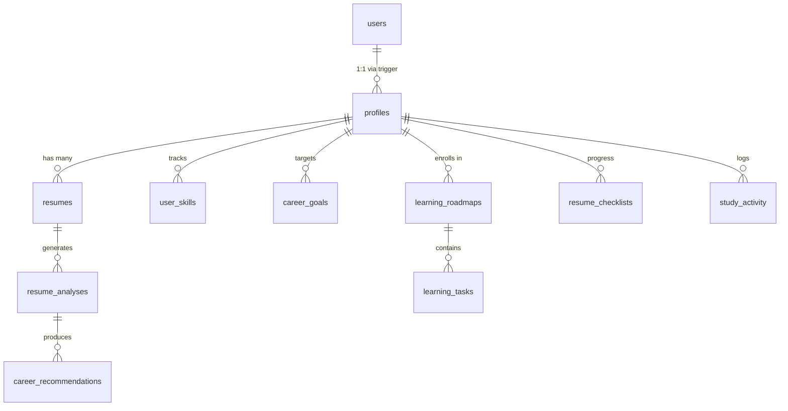

# Careerly – AI Career Navigator (Full-Stack Next.js 14 & Supabase)
> **Discover Your Path. Build Your Future.**

Careerly is a production-grade, full-stack career acceleration platform built with **Next.js 14 (App Router)**, **TypeScript**, **Tailwind CSS**, and **Supabase (PostgreSQL, Auth & Storage)**.

**100% Free to Run:** Careerly operates natively using an advanced, deterministic **Rule-Based Resume Analysis & Career Recommendation Engine**. It requires **ZERO paid AI APIs, zero OpenAI subscriptions, and zero billing**.

---

## 🏗️ Architecture & Technology Stack

| Layer | Technology | Details |
|---|---|---|
| **Frontend** | Next.js 14 (App Router), React 18, TypeScript | Fully responsive, SSR/SSG, Lucide Icons, Canvas Radar & Progress visualization |
| **Styling** | Tailwind CSS | Custom Careerly design system: Indigo/Violet palette, slate tones, light & dark mode |
| **Backend & APIs** | Next.js Route Handlers (`app/api/*`) | Server-side validation, secure auth session extraction, stream handling |
| **Database** | Supabase (PostgreSQL) | Strict Row Level Security (RLS) on all tables; auto-profile trigger on signup |
| **Authentication** | Supabase Auth | Email & Password signup, login, session refresh, password reset, protected route middleware |
| **File Storage** | Supabase Storage (`resumes` bucket) | Private storage, authenticated RLS policies, user-scoped storage paths |
| **Resume Extraction** | `pdf-parse` & `mammoth` | Server-side binary buffer parsing for PDF & DOCX; scanned/empty detection |
| **Analysis Engine** | Deterministic Rule-Based Engine | **100% Free**: 180+ technical skills taxonomy, 32-point ATS checklist, boundary matching, benchmark gap calculation |

---

## 🌟 Key Features & Capabilities

### 1. 100% Free Deterministic Rule-Based Engine
- **Zero Third-Party AI Billing**: Runs directly on your secure Next.js server with no external API calls, token costs, or subscription requirements.
- **Deep Technical Skills Taxonomy**: Recognizes 180+ languages, frameworks, databases, cloud platforms, and DevOps tools with word-boundary accuracy.
- **Academic & Contact Parsing**: Detects degrees (B.Tech, B.S., M.S., BCA, MCA), institutions, graduation years, GPA/percentages, emails, phone numbers, and portfolio links.
- **Industry ATS Audit (32-Point Criteria)**: Evaluates quantifiable impact metrics (e.g. `reduced latency by 35%`, `20,000+ requests`), strong action verbs, section organization, and text readability.
- **Objective Scoring**: Generates transparent, actionable strengths, high-yield weaknesses, and suggestions based on verified resume contents.

### 2. Real User Authentication & Security
- **Multi-Tenant Isolation**: Every registered user has an isolated account. Users can never view or manipulate another user's resumes, skills, or roadmaps.
- **Strict Row Level Security (RLS)**: Enforced directly at the PostgreSQL layer via `auth.uid() = user_id`.
- **Protected Routes**: Middleware (`middleware.ts`) protects `/dashboard`, `/upload`, `/resume`, `/skill-gap`, `/roadmap`, and `/profile`. Unauthenticated visitors are automatically redirected to `/auth/login`.

### 3. Real Resume Upload & Verification
- **Supported Formats**: `.pdf` and `.docx` up to 5MB (configurable).
- **Server-Side Extraction**:
  - `pdf-parse` extracts clean text streams from PDF files.
  - `mammoth` extracts structured prose from Word documents.
  - Automatic detection of empty, corrupted, or scanned image-only files with clear user feedback.
- **User Review & Corrections**: Users can review extracted contact info, education, skills, and experience, making edits before running the audit.
- **Private Storage**: Uploaded files reside in a non-public Supabase bucket under the user's secure folder (`{userId}/{timestamp}-{filename}`).

### 4. Interactive Skill Gap & Canvas Radar Visualizer
- **14 Pre-Built Tech Careers**: Comprehensive competency benchmarks across Software Engineering, AI/ML, Cloud/DevOps, Cybersecurity, Product Management, Data Engineering, and UI/UX.
- **Canvas Radar Chart**: Real-time visual comparison of verified competencies vs. target benchmarks.
- **Deficit Engine**: Identifies highest-priority skill gaps and automatically suggests targeted actions.

### 5. Personalized Learning Roadmaps & Milestones
- **Phased Curriculum**: Foundations, Core Tech Stack, System Design & Architecture, Production Deployment, and Capstone Projects.
- **Interactive Checkbox Persistence**: Milestone toggles recompute roadmap progress and save immediately to PostgreSQL.
- **Milestone Celebration**: Modal popup celebrating completion of roadmap phases.

### 6. Job Readiness Command Center
- **Aggregated Index**: Dynamic 0-100% score calculated server-side from 4 progress vectors:
  - Career Target Alignment (15%)
  - Skill Coverage vs Target Benchmark (35%)
  - Learning Roadmap Completion (35%)
  - Resume Quality & ATS Readiness (15%)
- **Dynamic Next Steps**: Server-computed recommendations based on current user state.
- **Zero Mock Data**: Displays a helpful onboarding empty state if the user has not yet uploaded a resume or selected a role.

---

## 🚀 Getting Started

### 1. Prerequisites
- **Node.js**: v18.18.0 or later (v20+ recommended)
- **Supabase Account**: [Create a free Supabase project](https://supabase.com)
- **Zero Paid AI Required**: No OpenAI API key or billing required!

### 2. Environment Setup
Copy `.env.example` to `.env.local`:

```bash
cp .env.example .env.local
```

Your `.env.local` only needs your Supabase configuration:
```env
# Supabase Configuration (Free Tier)
NEXT_PUBLIC_SUPABASE_URL=https://your-project-id.supabase.co
NEXT_PUBLIC_SUPABASE_ANON_KEY=your-supabase-anon-key
SUPABASE_SERVICE_ROLE_KEY=your-supabase-service-role-key

# Application Settings
NEXT_PUBLIC_APP_URL=http://localhost:3000
MAX_UPLOAD_SIZE_MB=5
```

### 3. Database & Storage Initialization
1. In your **Supabase Dashboard**, open the **SQL Editor**.
2. Open [`supabase/schema.sql`](./supabase/schema.sql) in this repository and copy the entire file.
3. Paste and run the query in the Supabase SQL Editor.
   - This creates all 10 tables (`profiles`, `resumes`, `resume_analyses`, `career_recommendations`, `user_skills`, `career_goals`, `learning_roadmaps`, `learning_tasks`, `resume_checklists`, `study_activity`).
   - Sets up the `on_auth_user_created` trigger for automated profile generation on signup.
   - Configures the private `resumes` storage bucket with user-scoped Row Level Security.

### 4. Install Dependencies
```bash
npm install
```

### 5. Run Development Server
```bash
npm run dev
```
Open [http://localhost:3000](http://localhost:3000) in your browser.

### 6. Production Build
```bash
npm run build
npm start
```

---

## 🗄️ Database Schema Diagram



---

## 📡 API Endpoints Reference

| Method | Endpoint | Description |
|---|---|---|
| `GET / PUT` | `/api/auth/profile` | Retrieve or update current user profile |
| `POST` | `/api/resumes/upload` | Upload PDF/DOCX, parse text, create resume record |
| `GET / PUT / DELETE`| `/api/resumes/[id]` | Inspect, edit extracted text, or delete resume file and record |
| `POST` | `/api/resumes/[id]/analyze` | Run rule-based audit and generate career recommendations |
| `GET / POST / PUT / DELETE` | `/api/skills` | Manage user verified skills and proficiency levels |
| `GET / POST` | `/api/careers/recommendations` | Get career matches or set target career goal |
| `GET / POST` | `/api/roadmaps` | Fetch active roadmap or toggle milestone task completion |
| `GET` | `/api/dashboard` | Fetch aggregated Job Readiness Index and metrics |
| `POST` | `/api/user/delete-account` | GDPR-compliant account, storage, and data wipe |

---

## 🛡️ Security & Privacy Protections
1. **Zero External Data Transmission**: Resume text and user profile data are never sent to external AI vendors or paid APIs.
2. **Private Storage**: Resumes are stored in a non-public bucket (`resumes`), accessible only to the authenticated uploader via PostgreSQL RLS policies.
3. **GDPR / Privacy Compliance**: Full account deletion wipes storage files, database records, and auth credentials.

---

## 🚀 Deploying to Vercel

1. Push your repository to GitHub / GitLab / Bitbucket.
2. Go to [Vercel](https://vercel.com) and click **"Add New Project"**.
3. Import this repository.
4. Add the Environment Variables:
   - `NEXT_PUBLIC_SUPABASE_URL`
   - `NEXT_PUBLIC_SUPABASE_ANON_KEY`
   - `SUPABASE_SERVICE_ROLE_KEY`
   - `NEXT_PUBLIC_APP_URL`
5. Click **Deploy**.

---

## 📄 License
This project is proprietary and built exclusively for Careerly. All rights reserved.
